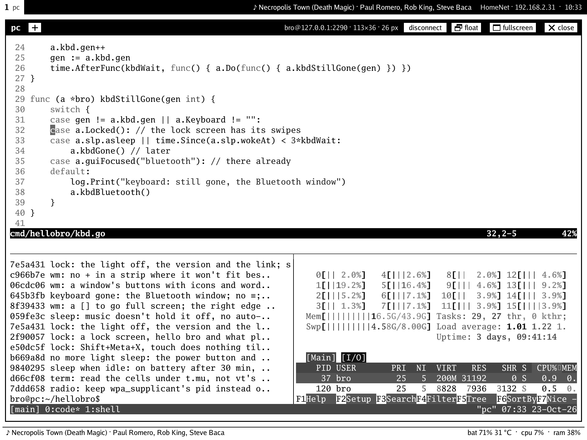
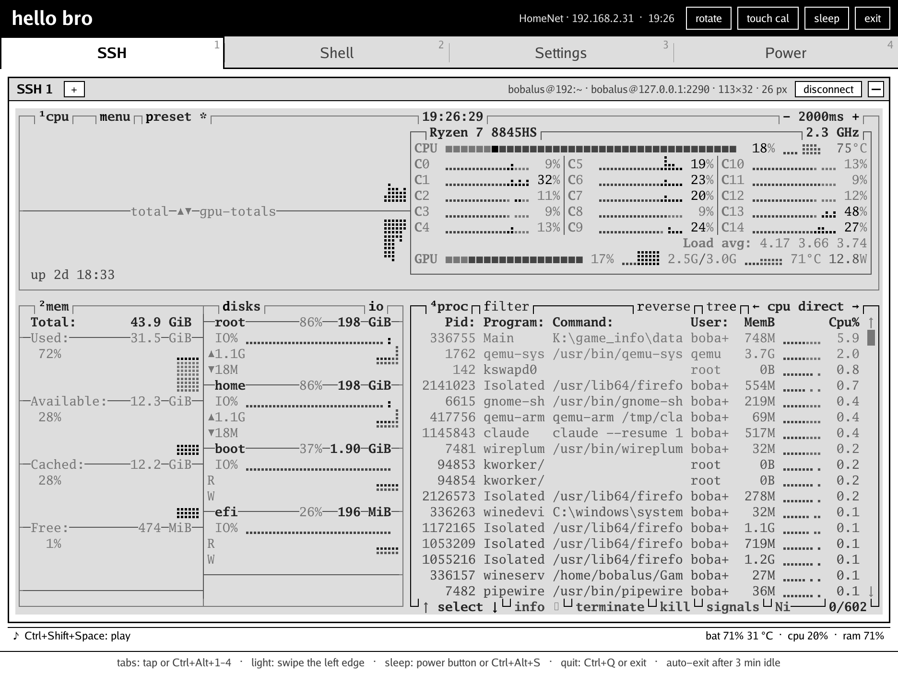
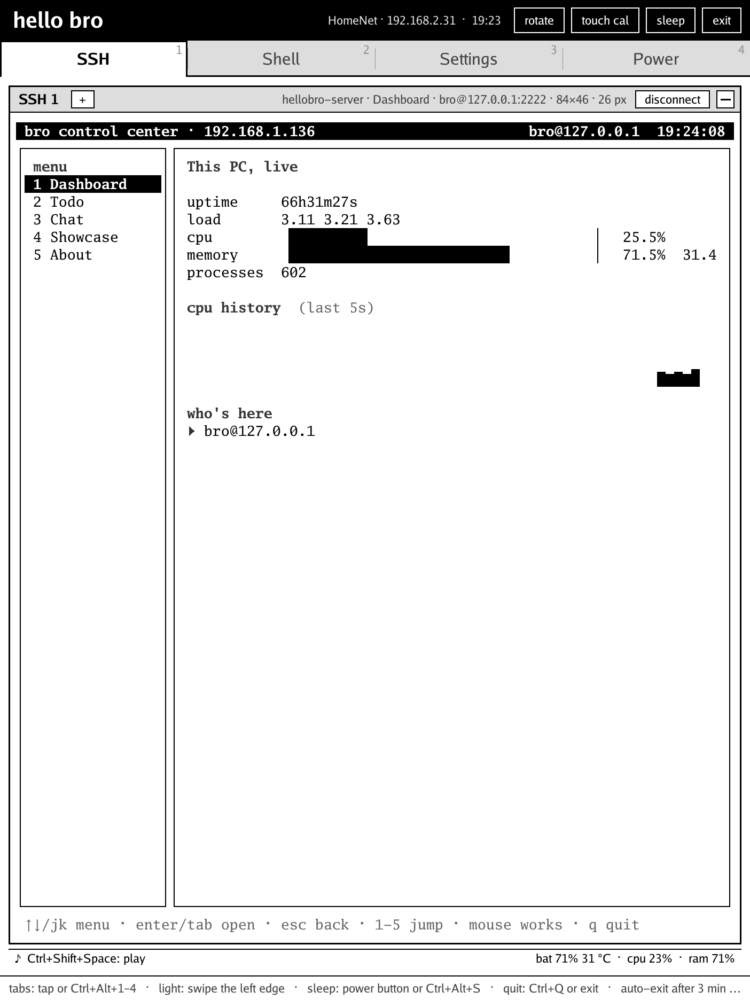
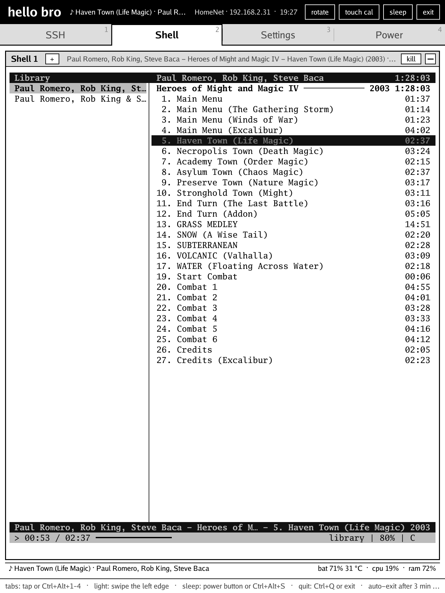
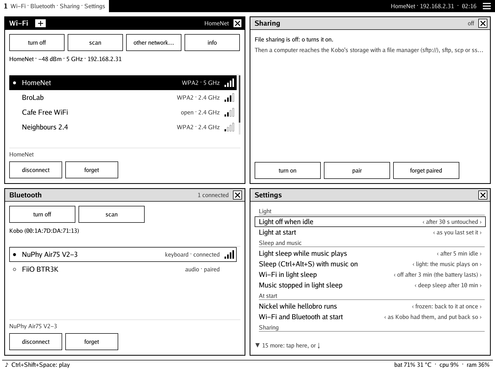
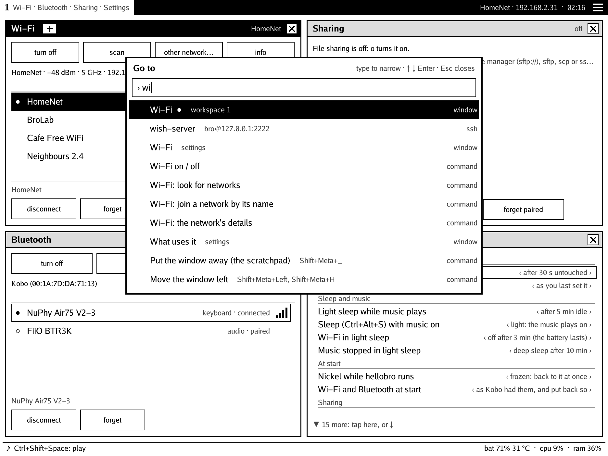

# hello bro

A terminal, a Linux in your pocket and a way in for your computer, on a
Kobo e-reader. Bring a Bluetooth keyboard.

<p align="center">
  
  
</p>
<p align="center">
  
  
</p>
<p align="center">
  
  
</p>

hellobro takes the screen over from Nickel, draws its own e-ink UI through
[FBInk](https://github.com/NiLuJe/FBInk), and gives Nickel back when you
leave. It's built for the Kobo Elipsa (N604) and written in Go.

## What it does

- **Windows, as i3 has them**: a tiling window manager with i3's keys
  (Meta+Enter, Meta+arrows, Meta+1…0), workspaces, splits, tabbed and
  stacked containers, floating windows, a scratchpad, binding modes, and
  i3's IPC, so `i3-msg`, `swaymsg` and i3ipc scripts work, and
  `hellobro-msg notify TEXT` puts up a note. One slim bar at the top
  lists each workspace's windows. The windows
  come back as they were left.
- **SSH**: an xterm-256color terminal, as many as you like, mouse,
  reconnects by itself. tmux, htop, helix, Claude Code all work.
- **Shell**: Alpine Linux in a jail, with `apk` for tools, or the same
  terminal on the Kobo itself.
- **Music**: mpv, cmus or any Linux player with MPRIS, in Alpine, to
  Bluetooth headphones. The media keys and the headphones' buttons work,
  and the status bar shows what plays.
- **Sleep when idle**: untouched for 30 minutes on battery (Settings),
  the Kobo sleeps, so one left on the shelf keeps its charge.
- **Host files**: a saved host's home mounted for Alpine, read-only or
  read-write: copy, rsync, or play music straight from the PC.
- **Settings**: Wi-Fi and Bluetooth without going back to Nickel, and
  sharing: SFTP and SSH for a paired computer (`kobo.local`). Updates go
  over the air.
- **Power**: the battery (draw, time left, drain rate, a 12 h graph) and
  what's using it, powertop style.
- **From afar**: a relay through a VPS, so the Kobo and your PC reach
  each other away from home.

## Install

You need a Kobo with [NickelMenu](https://pgaskin.net/NickelMenu/)
installed. hellobro is built and tested on the Elipsa (N604, firmware
4.38).

1. Download `hellobro-<version>.zip` from the
   [latest release](https://github.com/shabunin/hellobro/releases/latest).
2. Plug the Kobo in over USB and choose Connect, so it shows up as a
   drive (`KOBOeReader`).
3. Unzip the file into the top of that drive. It holds a `.adds` folder,
   which merges with the one already there (NickelMenu's):
   `.adds/hellobro/` is the app, `.adds/nm/hellobro` its menu entry.
   `.adds` is hidden, so if your file manager won't show it, unzip from
   a terminal: `unzip hellobro-<version>.zip -d /path/to/KOBOeReader`.
4. Eject the Kobo. Open **Hello Bro** from NickelMenu (the menu at the
   bottom right of the home screen). The first start asks you to tap two
   targets, to calibrate the touch screen. Meta+Shift+E (Meta is the
   Win key), or quit in the bar's ≡ menu, goes back to Nickel.

### Updates over Wi-Fi

Pair the computer once:

1. In hellobro, open Settings and press `pair` under Sharing (it turns
   file sharing on).
   It shows a code.
2. On the computer, run `ssh -p 2022 kobo.local` and type the code.

Then, for a new release, download the bare `hellobro` file and send it:

```sh
scp -P 2022 hellobro kobo.local:/mnt/onboard/.adds/hellobro/hellobro.new
ssh -p 2022 kobo.local hellobro-update
```

hellobro restarts into the new build, and goes back to the old one by
itself if the new one fails. Unzipping a new release over USB works too.
If `kobo.local` doesn't resolve, use the Kobo's IP (Settings, Wi-Fi).

### From source

You need podman for the build.

```sh
make                 # static ARM build, in a container
make install         # to the Kobo, mounted over USB
make push            # later: a new build over Wi-Fi (paired, as above)
make dist            # a release's files, in dist/
```

## Keys

| | |
| --- | --- |
| Meta+Enter | a new window: 1 Alpine, 2 the Kobo's sh, 3… a saved host |
| Meta+D, Meta+Space | go to: windows, workspaces, hosts, settings, commands |
| Meta+arrows (or H J K L), with Shift | focus the window there, move it there |
| Meta+1…0, with Shift | go to a workspace, send the window there |
| Meta+B, Meta+V | split: the next window beside, below |
| Meta+E, Meta+W, Meta+S | side by side ⇄ one above another, tabbed, stacked |
| Meta+F | fullscreen (swipe in from the top or bottom edge to leave) |
| Meta+Shift+Space | floating |
| Meta+R | resize: the arrows, then Esc |
| Meta+Shift+Q | close the window |
| pen across text, Ctrl+Shift+V | copy, paste |
| Ctrl+Shift+Space | play / pause, anywhere |
| Ctrl+Shift+< / > | previous / next track |
| Ctrl+Alt+S, power button | sleep |
| swipe the left edge, Ctrl+Alt+Up / Down | frontlight |
| Ctrl+Alt+L | frontlight on / off |
| Meta+Shift+E, ≡ (the bar's menu) | back to Nickel |

Every key can be changed in Settings (Keys) or `keys.conf`, which takes
any i3 command line and binding modes. See [Keys](docs/usage.md#keys)
and [i3's IPC](docs/usage.md#i3s-ipc).

## Docs

- [Using hellobro](docs/usage.md): the windows, every one of them, sleep, sharing, updates
- [From afar](docs/relay.md): the relay through a VPS
- [Developing](docs/development.md): code, building, the test harness
- [AGENTS.md](AGENTS.md): for coding agents

The tabs as they were before the windows (v0.2.1) live on the
[`legacy`](https://github.com/shabunin/hellobro/tree/legacy) branch.

**Bro Tools**, a diagnostics app (keys, touch, stylus, network, sound,
system), lives here too. It's only installed on request:
`make install-tools`.

## License

[GPL-3.0-or-later](LICENSE). hellobro links in
[FBInk](https://github.com/NiLuJe/FBInk) by NiLuJe, also GPL-3.0-or-later.
Its prebuilt files and their source are described in
[third_party/fbink](third_party/fbink/README.md).

<sub>The screenshots come from the test harness on a PC (`harness/`),
with the app's own rendering.</sub>
