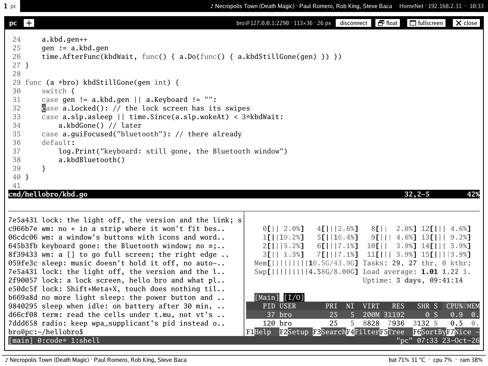
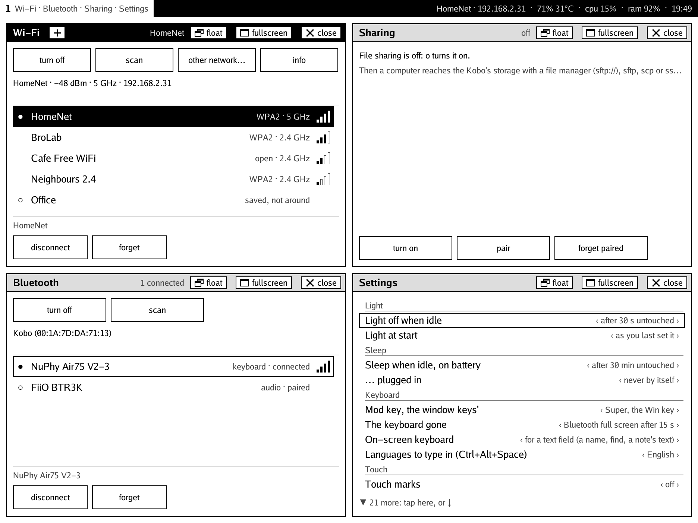
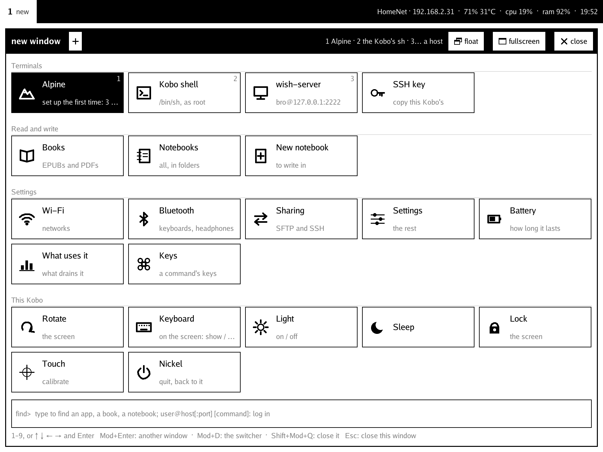

# hello bro

A terminal, a Linux, books, notebooks and a calendar on a Kobo
e-reader. Bring a Bluetooth keyboard, or use your fingers and the pen.

<p align="center">
  
  
</p>
<p align="center">
  
</p>

hellobro takes the screen over from Nickel, draws its own e-ink UI, and
gives Nickel back when you leave. It's built for the Kobo Elipsa (N604)
and written in Go.

## What it does

- **Windows** like i3: tiling, workspaces, i3's keys and IPC
- **Terminals**: SSH to your computers, or Alpine Linux on the Kobo
- **Books**: EPUBs and PDFs, with dictionaries
- **Notebooks**: write with the pen; an AI that answers your handwriting, if you like
- **Calendar**: events and tasks, synced over CalDAV or from Google; the agenda on the sleep screen
- **Music**: Linux players in Alpine, to Bluetooth headphones
- **Settings**: Wi-Fi, Bluetooth, the battery, file sharing, updates over Wi-Fi

## Install

You need [NickelMenu](https://pgaskin.net/NickelMenu/) on the Kobo.

1. Download `hellobro-<version>.zip` from the
   [latest release](https://github.com/shabunin/hellobro/releases/latest).
2. Connect the Kobo over USB and unzip the file into the top of its
   drive (it holds a hidden `.adds` folder).
3. Eject it and open **Hello Bro** from NickelMenu.

To leave, swipe down the right edge and tap quit (or Mod+Shift+E).

## Updates

Pair your computer once (Settings, Sharing, `pair`, then
`ssh -p 2022 kobo.local` and type the code). After that:

```sh
scp -P 2022 hellobro kobo.local:/mnt/onboard/.adds/hellobro/hellobro.new
ssh -p 2022 kobo.local hellobro-update
```

From source (podman needed): `make`, then `make push`.

## Getting around

- Mod+Enter: a new window (Mod is the Win key)
- Mod+D: go to anything
- Swipe the left edge: the light; the right edge: the menu
- Tap the top bar: all the workspaces

Everything else is in [the docs](docs/usage.md).

## Docs

- [Using hellobro](docs/usage.md)
- [From afar](docs/relay.md): reaching the Kobo through a VPS
- [Developing](docs/development.md)
- [AGENTS.md](AGENTS.md): for coding agents

## License

[GPL-3.0-or-later](LICENSE). It links in
[FBInk](https://github.com/NiLuJe/FBInk) by NiLuJe (GPL-3.0-or-later,
see [third_party/fbink](third_party/fbink/README.md)) and carries Gentium
Book and STIX Two Math under the SIL Open Font License 1.1
([third_party/fonts](third_party/fonts)).
