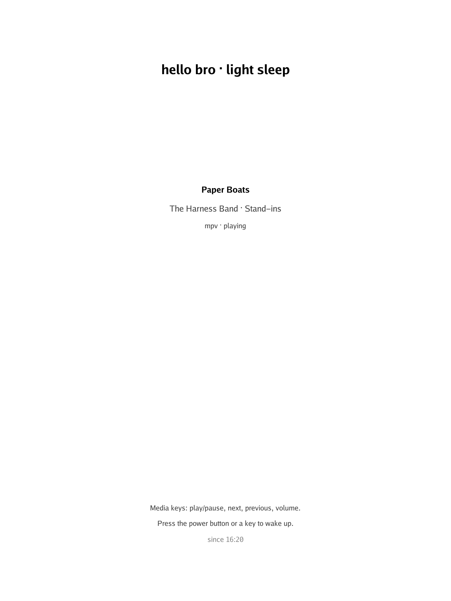
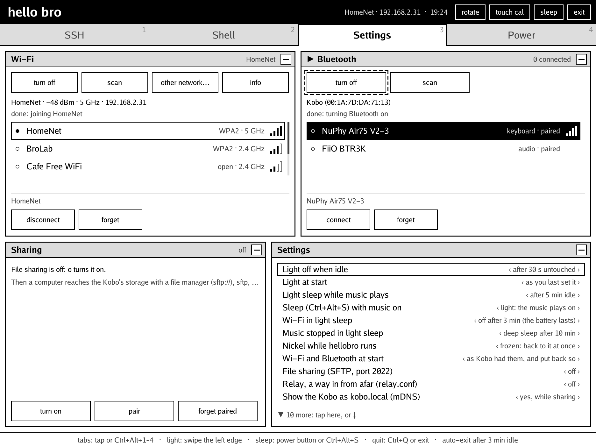

# hello bro

A terminal, a music player and a way in for your computer, on a Kobo
e-reader. Bring a Bluetooth keyboard.

<p align="center">
  
  
</p>
<p align="center">
  
  
  
</p>
<p align="center">
  
  
</p>

hellobro takes the screen over from Nickel, draws its own e-ink UI through
[FBInk](https://github.com/NiLuJe/FBInk), and gives Nickel back when you
leave. It's built for the Kobo Elipsa (N604) and written in Go.

## What it does

- **SSH**: an xterm-256color terminal, several sessions, mouse,
  reconnects by itself. tmux, htop, helix, Claude Code all work.
- **Shell**: the same terminal on the Kobo itself (turn it on in
  Settings, Tabs).
- **Music**: albums, folders and playlists, shuffle and repeat, to
  Bluetooth headphones. Media keys work.
- **Light sleep**: the screen shows what's playing, the light goes off,
  and the music keeps going.
- **Settings**: Wi-Fi and Bluetooth without going back to Nickel.
- **Files**: SFTP and SSH for a paired computer (`kobo.local`). Updates
  go over the air.
- **From afar**: a relay through a VPS, so the Kobo and your PC reach
  each other away from home.

## Get started

You need a Kobo with [NickelMenu](https://pgaskin.net/NickelMenu/), and
podman on the computer for the build.

```sh
make                 # static ARM build, in a container
make install         # to the Kobo, mounted over USB
```

Eject the Kobo and open **hellobro** from NickelMenu. Then go wireless:

1. On the Kobo, open Files and press `pair`. It shows a code.
2. On the computer, run `ssh -p 2022 kobo.local` and type the code.
3. From then on, `make push` installs a new build over Wi-Fi.

## Keys

| | |
| --- | --- |
| Ctrl+Alt+1–4 | tabs |
| Ctrl+Shift+P | go to: sessions, tabs, hosts, commands |
| Ctrl+Tab, Ctrl+Shift+Tab | next / previous panel (or session) |
| Ctrl+Shift+M | minimize / open the panel in focus (Enter opens it too) |
| Ctrl+Shift+T | new session |
| pen across text, Ctrl+Shift+V | copy, paste |
| F11 | fullscreen (swipe in from the top or bottom edge to leave) |
| Ctrl+Shift+Space | play / pause, on any tab |
| Ctrl+Shift+< / > | previous / next track |
| Ctrl+Alt+S, power button | sleep |
| swipe the left edge, Ctrl+Alt+Up / Down | frontlight |
| Ctrl+Alt+L | frontlight on / off |
| Esc, `exit` | back to Nickel |

Every key can be changed in Settings (Keys) or `keys.conf`, and which tabs show (Shell
starts hidden), and in what order, in Settings. See
[Keys](docs/usage.md#keys).

## Docs

- [Using hellobro](docs/usage.md): every tab, sleep, sharing, updates
- [From afar](docs/relay.md): the relay through a VPS
- [Developing](docs/development.md): code, building, the test harness
- [AGENTS.md](AGENTS.md): for coding agents

**Bro Tools**, a diagnostics app (keys, touch, stylus, network, sound,
system), lives here too. It's only installed on request:
`make install-tools`.

## License

[GPL-3.0-or-later](LICENSE). hellobro links in
[FBInk](https://github.com/NiLuJe/FBInk) by NiLuJe, also GPL-3.0-or-later.
Its prebuilt files and their source are described in
[third_party/fbink](third_party/fbink/README.md).

<sub>The screenshots come from the test harness on a PC (`harness/`),
with the app's own rendering.</sub>
